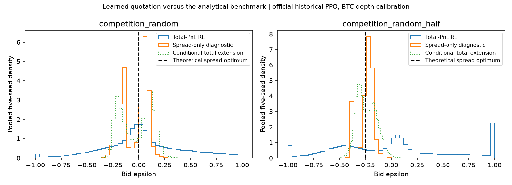
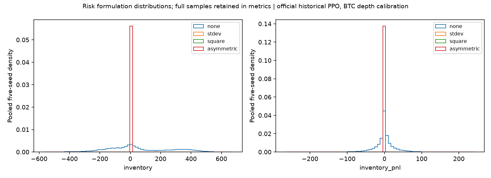

# Best-effort paper reproduction with BTC depth calibration

Uses official historical RLlib PPO and the disclosed price/spread laws; BTC replaces depth statistics only. Undisclosed author settings remain explicit assumptions. This is not exact numerical replication of the original MSFT study.

## Completed experiments

- Ten preprocessing pilot runs selected using validation only; 200 main runs (40 scenarios x five seeds); ten spread-only pricing diagnostics; ten conditional-reward extension runs; fifteen fixed risk-sensitivity training runs and thirty fresh evaluations of frozen reference policies.
- Each main final evaluation contains 32,000 fresh simulated records. All seed summaries and training logs are included. Policy weights and per-step arrays are excluded from this public archive and can be regenerated. Failed stability checks remain reported.
- Five-seed validation mean: raw inputs 0.114997, MeanStdFilter -0.051393; selected none without using final test data.
- Empirical stability checks passed in 1/100 learning runs. These compare clipped actions and validation rewards and do not prove optimality; latent Gaussian KL is retained separately.

## Competitive returns

Own minus opponent mean PnL per step, multiplied by 100. Intervals use variation across five model seeds, not individual correlated time steps.

|Opponent|Mean excess PnL x100|Across-seed 95% interval|Positive seeds|
|---|---:|---|---:|
|competition_persistent_half|-5.757|[-24.157, 12.643]|1/5|
|competition_persistent|3.896|[-14.563, 22.354]|3/5|
|competition_random_half|19.828|[-2.075, 41.732]|4/5|
|competition_random|26.547|[13.403, 39.691]|5/5|

## Pricing diagnostics

The theoretical spread-revenue optimum is 0 against Uniform[-1,1] and -0.25 against Uniform[-0.5,0.5]. Normalized analytical quote efficiency divides expected spread revenue by its statewise optimum; 1 is optimal. This is not total PnL or live trading return.

|Opponent|Main total-PnL reward|Spread-only diagnostic|Conditional-total extension|
|---|---:|---:|---:|
|competition_random|76.02%|97.43%|97.80%|
|competition_random_half|56.38%|97.61%|98.44%|

The conditional-total extension replaces only training inventory PnL with its GBM conditional mean. Final evaluation uses realized random total PnL. Expected total PnL is preserved for a fixed policy under independent investor flow without nonlinear risk penalties. This model-informed exploratory extension is not an author-confirmed method; toxic flow and risk penalties are rejected. See `../../v4/VARIANCE_EXTENSION.md`.

|Opponent|Main policy realized test PnL|Conditional-total extension realized test PnL|
|---|---:|---:|
|competition_random|0.190625|0.119078|
|competition_random_half|0.157243|0.143098|

See `inventory_noise_decomposition.csv` for realized versus conditional reward variance under the same frozen policy. Lower training reward variance does not by itself imply higher test returns.

## Drift and risk findings

- Mean inventory for mu=-1,-0.01,0,0.01,1: -576.928, -7.733, -14.278, 29.284, 558.611.
- Extreme-drift inventory signs correct: True; all five means monotone: False.
- The table reports standard-deviation changes relative to the no-penalty policy. Negative values indicate reductions. Market share must be considered alongside inventory: stopping trading is not sufficient evidence of successful inventory management.

|Penalty|Inventory SD change|Inventory-PnL SD change|Mean market share|
|---|---:|---:|---:|
|stdev|-98.7845|-24.0746|0.000%|
|square|-98.7612|-24.0736|0.002%|
|asymmetric|-98.7845|-24.0746|0.000%|

### Risk-strength sensitivity (post hoc exploratory extension)

After the main policies largely stopped trading, a separate extension multiplied all three penalty coefficients by 0.1. Main results remain unchanged. Fresh common simulated streams compare frozen no-penalty, original-coefficient and scaled-coefficient policies; the first two groups are not retrained. This investigates BTC calibration scale sensitivity, not successful replication with the original coefficients.

|Penalty|Model group|Market share|Inventory SD|Inventory-PnL SD|
|---|---|---:|---:|---:|
|risk_stdev|no_penalty|41.035%|98.241|24.028|
|risk_stdev|original_alpha|0.000%|0.000|0.000|
|risk_stdev|scaled|24.319%|16.578|2.442|
|risk_square|no_penalty|41.035%|98.241|24.028|
|risk_square|original_alpha|0.003%|0.034|0.005|
|risk_square|scaled|16.302%|11.100|1.537|
|risk_asymmetric|no_penalty|41.035%|98.241|24.028|
|risk_asymmetric|original_alpha|0.000%|0.000|0.000|
|risk_asymmetric|scaled|27.441%|47.052|9.873|

- Toxic-flow case: mean excess PnL x100 404.696; mean hedge-fraction difference 0.1634. Positive point estimates alone do not establish a statistically supported joint claim of better returns and more aggressive hedging.

Full intervals and inventory-dependent quote skew appear in `behavior_checks.json` and `inventory_skew.csv`. Comparisons are exploratory, without multiplicity adjustment; five model seeds provide limited interval precision.

## Figures and verification

Figure 1 separates main policies from pricing diagnostics. Figure 2 contains RL training curves only (opponent training rewards were not recorded). Figures 3 and 5 pool seeds descriptively. Figures 4 and 12-14 consistently use seed 0. Figures 6-7 show the BTC-calibrated reference market; figures 8-11 retain all five training seeds.

Per-seed counterparts of paper tables 1-6 are in `table_1_per_seed.csv` through `table_6_per_seed.csv`. See `all_seed_metrics.csv` for main outcomes and `scenario_effects.csv` for seed-level intervals. Model weights and per-step evaluation arrays are generated by rerunning the experiments and are not bundled in the public archive.

## Scope and limitations

This reproduces a simulated dealer market with synthetic investor orders and best-quote execution. It does not model real exchange queues, cancellation latency, capital/margin constraints or market impact. BTC supplies depth statistics only. Normalized PnL is not a BTC live return. Undisclosed depth scaling, inventory bounds, preprocessing and software configuration remain assumptions. Modified-reward diagnostics remain separate from the main experiment.
